<!-- ═════════════════════════ HEADER ═════════════════════════ -->
<div align="center">



<p>
  <a href="mailto:benhassenilef20@gmail.com"></a>
  <a href="https://www.linkedin.com/in/ilef-ben-hassen"></a>
</p>
<p>
  
  
  
  
</p>

</div>

---

## 👩‍💻 About Me

Engineering student in **Data Science & Artificial Intelligence** at **TEK-UP University** (Ariana, Tunisia). I build **end-to-end ML systems** — from data pipelines and models to APIs, dashboards and containerized deployments — with a strong foundation in **full-stack development, DevOps and cloud**.

```yaml
name:        Ilef BEN HASSEN
role:        Data Science & AI Engineering Student
university:  TEK-UP University (2024 – present)
prep_school: ULT — Math, Physics & CS prep (2022 – 2024)
location:    Tunisia
languages:   [Arabic (native), English (B2), French (B2), German (B1)]
currently:
  - Building AI-powered applications (RAG, ML, multi-source data pipelines)
  - Going deeper into MLOps & cloud-native AI
  - Preparing AWS certifications (AI Practitioner, Data Engineer)
ask_me_about: [Python, FastAPI, Docker, RAG, Django, React, Linux]
status:      Open to internships, full-time roles & freelance missions
```

---

## 🚀 Featured Projects

| Project | What it does | Stack |
|---|---|---|
| 🛡️ **CyberWatch AI** | Full-stack vulnerability-watch platform indexing **11,800+ CVEs across 81 products**; daily ingestion from **17 cybersecurity sources** (NVD, MITRE, CERT-FR, CISA…) with a 3-level source-authenticity agent and a **RAG assistant** answering only from validated data (**770 automated tests**) | `FastAPI` `MongoDB` `React` `Playwright` `RAG` `Docker Compose` |
| 🌱 **VigorTerra** | AI platform for smart agriculture: crop-yield prediction, disease-risk assessment and soil-productivity analysis, with real-time predictions and MLflow experiment tracking | `Python` `Scikit-Learn` `XGBoost` `FastAPI` `React` `Docker` `MLflow` |
| ⚖️ **CSIS** | Social-vulnerability early-detection (Logistic Regression, Random Forest, XGBoost) + a **RAG legal assistant** grounded in the Tunisian legal corpus | `Python` `XGBoost` `NLP` `RAG` `Vector DB` `LLM` |
| 🧙 **Wizard World** | Full digital companion & e-commerce platform for Harry Potter fans, prototyped in Balsamiq | `Django REST` `React.js` `PostgreSQL` |
| 🤖 **AI Conversational Chatbot** | Text & voice assistant built on a seq2seq / Transformer architecture — **92 % relevance score** on natural responses | `Python` `TensorFlow` `PyTorch` `NLP` |

---

## 💼 Experience

<table>
<tr>
<td width="170"><b>Jul – Aug 2026</b></td>
<td><b>AI / Full-Stack Intern — Advancia IT System</b> <i>(Lac 1, Tunis)</i><br/>
Built <b>CyberWatch AI</b> (FastAPI · MongoDB · React): automated daily CVE collection via APIs, RSS and Playwright scraping, three-level source-authenticity agent, RAG assistant, Docker Compose deployment.</td>
</tr>
<tr>
<td><b>Feb – Mar 2026</b></td>
<td><b>Certified Python (PCAP™) Instructor — TEK-UP University</b><br/>
Coached <b>30+ students</b> every weekend (9 am – 3 pm) in an intensive PCAP™ preparation course.</td>
</tr>
<tr>
<td><b>Jul – Aug 2025</b></td>
<td><b>Full-Stack Developer Intern — Progress Engineering</b> <i>(Ariana)</i><br/>
Backend & frontend modules for business-opportunity tracking: authentication, user management, advanced filtering, testing, performance tuning and documentation. <code>Symfony</code> <code>PHP</code> <code>MySQL</code> <code>JavaScript</code> <code>Git</code></td>
</tr>
<tr>
<td><b>Aug 2024</b></td>
<td><b>Intern — Délice Holding</b> <i>(Soliman)</i><br/>
LAN, network devices & IP addressing fundamentals; workstation setup; exposure to finance and quality-control operations.</td>
</tr>
</table>

---

## 🛠️ Tech Stack

<div align="center">

**Languages**<br/>


**AI & Machine Learning**<br/>


**Web & Frameworks**<br/>


**DevOps & Cloud**<br/>


**Data & Databases**<br/>


</div>

<details>
<summary><b>📋 Full skills breakdown</b></summary>

| Domain | Skills |
|---|---|
| **AI / ML** | Supervised & unsupervised learning, XGBoost, Random Forest, K-Means, NLP, Transformers, RAG, vector databases, LLMs, MLflow |
| **Backend** | FastAPI, Django REST Framework, Symfony, .NET, REST API design |
| **Frontend** | React, JavaScript, HTML5, CSS3 |
| **DevOps & Cloud** | Docker, Docker Compose, Git/GitHub, Linux (RHCSA), CI/CD, AWS, Microsoft Azure |
| **Data** | SQL, PostgreSQL, MySQL, MongoDB, Pandas, Power BI, Data Mining |
| **Methods** | Agile / Scrum, teamwork, problem solving |

</details>

---

## 🏆 Certifications

| | Certification | Issuer | Date |
|---|---|---|---|
| 📊 | **eLearnSecurity Junior Data Scientist (eJDS)** | INE | Oct 2026 |
| ☁️ | **INE Certified Cloud Associate (ICCA)** | INE | May 2026 |
| 📦 | **Red Hat Certified Specialist in Containers (EX188)** | Red Hat | Apr 2026 |
| 🐧 | **Red Hat Certified System Administrator (RHCSA)** | Red Hat | Dec 2025 |
| 🐍 | **PCAP™ — Certified Associate Python Programmer** | Python Institute | Jul 2025 |
| ⏳ | AWS Certified AI Practitioner · AWS Certified Data Engineer – Associate | AWS | *In progress* |

---

## 🌍 Community & Leadership

- 🎯 **Sponsoring Responsible** — IEEE TEK-UP Student Branch *(2025 – present)*
- 🔐 **Member** — Securinets TEK-UP *(2024 – present)*
- 🎓 **Member** — IEEE Education Society *(2024 – present)*
- ❤️ **Member** — Tunisian Red Crescent *(2022 – 2024)*
- 🌐 **Member** — JCI Tunisia, Junior Chamber International *(2021 – 2022)*

---

## 📊 GitHub Activity

<div align="center">


<br/>


<br/><br/>


</div>

---

<!-- ═════════════════════════ FOOTER ═════════════════════════ -->
<div align="center">

### 📫 Let's connect

<a href="mailto:benhassenilef20@gmail.com"></a>
<a href="https://www.linkedin.com/in/ilef-ben-hassen"></a>

*✅ Open to internships & full-time roles &nbsp;·&nbsp; ✅ Available for freelance &nbsp;·&nbsp; ✅ Open to collaborations*

*"Delivering clean, impactful & scalable solutions ✨"*


</div>
